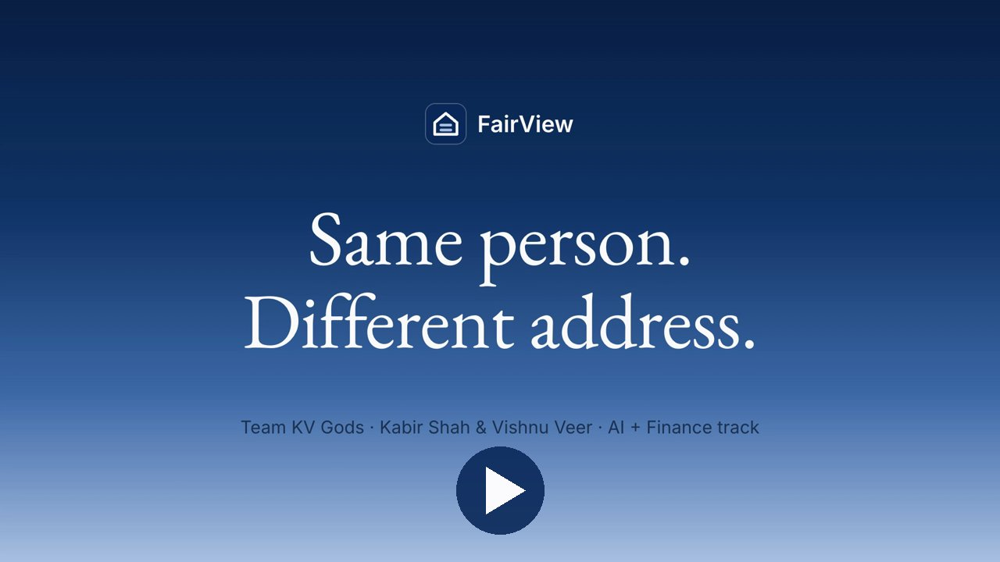
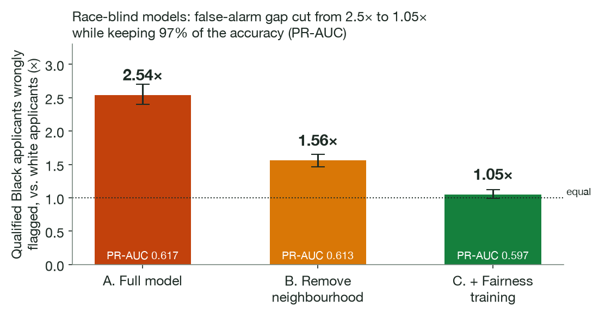

# FairView · Race-Blind Isn't Fair: Auditing a Mortgage Model for Neighbourhood Proxies

**Track:** AI + Finance · **Team:** KV Gods (Kabir Shah, Vishnu Veer)
**Starting point:** Extends suggested project 4.2.3 (fairness audit of a loan model) to real 2022–2023 US mortgage data
**Live demo:** https://fairview-ai.pages.dev (backup: https://kabirshah4.github.io/race-blind-isnt-fair/) · **Code:** https://github.com/kabirshah4/race-blind-isnt-fair

*This project is a prototype and is not financial advice.*

> ## In 10 seconds
> [](https://www.youtube.com/watch?v=ThfnVjNuL9M)
>
> **A mortgage AI that never sees race still flagged bank-approved Black applicants as likely denied about 3× as often as white ones, largely through neighbourhood data.** Dropping neighbourhood data and adding fairness training cuts that to about 1.2×.
>
> - **Try it live:** [fairview-ai.pages.dev](https://fairview-ai.pages.dev) (same person, switch only the address; works on phones)
> - **The data:** 264,340 real Georgia applications (public HMDA data, so no credit scores); a smaller but similar gap in North Carolina (about 2×)
> - **The finding:** 2,718 bank-approved Black Georgians flagged as likely denied by a race-blind model (stable across 5 retrains: 2.85–2.95×); neighbourhood explains roughly half of it; the gap survives county credit data (3.11×)
> - **Lender audit page:** [fairview-ai.pages.dev/lenders.html](https://fairview-ai.pages.dev/lenders.html): 30 of 60 Georgia lenders have gaps the finances we can see don't explain, after a correction for testing many lenders at once (a lead, not proof); all 60 GA and 42 NC lenders, anonymised
> - **The tool:** `python src/audit_lender.py --lei <lender>` gives a one-page screening report for any lender
>
> 

**→ One-page write-up: [WRITEUP.md](WRITEUP.md) · Methods, every check and caveats: [TECHNICAL.md](TECHNICAL.md)**

---

## How to run it

```bash
python3.12 -m venv .venv && source .venv/bin/activate
pip install -r requirements.txt

python src/download.py        # 1. download the public HMDA data (Georgia and North Carolina, 2022–2023)
python src/prep.py            # 2. clean it, remove leaky columns -> data/processed/
python src/train.py           # 3. baselines vs. models -> results_models.csv
python src/fix.py             # 4. models A/B2/B/C, validation choice of fairness rule, 95% CIs, per-group costs -> results_fix.md
python src/audit.py           # 5. fairness audit of model A + proxy detective -> results_audit.md
python src/counterfactual.py  # 6. "same person, different address" -> results_counterfactual.md
python src/other_state.py     #    second-state check, North Carolina -> results_nc.md
python src/audit_lender.py    #    lender-by-lender audit (anonymised) -> results_lenders.md; add --lei <LEI> for one lender
python src/asian_indian.py    #    Asian Indian vs. white numbers in WRITEUP 'Why we care' -> results_asian_indian.md
python src/case_study.py      #    one real applicant model A wrongly flags -> results_case_study.md
python src/lender_chart.py    #    lender chart + multiple-testing correction -> results_lenders_strict.md, figures/4_lenders.png
python src/seeds.py           #    retrain A, B, C with 5 seeds (training randomness) -> results_seeds.md
python src/robustness.py      #    credit stand-ins (Urban Institute county data), credit-history denials removed, same-flag-rate fix, stronger baselines, tract-level CIs -> results_robustness.md
python src/placebo.py         #    placebo tests: race labels shuffled, fake neighbourhoods -> results_placebo.md
python src/robustness_c.py    #    model C retrained on all of 2022 (slow) -> results_robustness_c.md
python src/export_lenders.py  #    lender results for the web page -> docs/lenders.json
python src/failures.py        #    where it fails: misses by the bank's denial reason, address-only false alarms, fix costs by group -> results_failures.md
python src/charts.py          # 7. charts -> figures/
python app/app.py             # 8. the demo app -> http://127.0.0.1:7860
python src/export_models.py   #    export the real models for the live web demo -> docs/models.json
```

Every script starts with a plain-English explanation of what it does and why.
**[NOTES.md](NOTES.md)** is our full step-by-step project log, including the leaks we caught and the review that found the third one.

| Folder | What's in it |
|---|---|
| `src/` | The pipeline: download → prep → train → fix → audit → counterfactual → charts |
| `app/` | The Gradio demo (runs the models live) |
| `docs/` | The live web demo: the real trained models run in your browser |
| `figures/` | Charts used in the write-up |
| `models/` | Trained models (so the demo runs without retraining) |
| `results_*.csv/md` | Raw result tables behind every number above |

## Sources

- **Data:** HMDA mortgage application data, CFPB/FFIEC (https://ffiec.cfpb.gov/data-browser/); Urban Institute, Debt in America, county credit data (https://apps.urban.org/features/debt-interactive-map/)
- **Research:** Fuster, Goldsmith-Pinkham, Ramadorai & Walther (2022), "Predictably Unequal? The Effects of Machine Learning on Credit Markets," *Journal of Finance* 77(1)
- **Libraries:** pandas, scikit-learn, XGBoost (https://xgboost.ai), fairlearn (https://fairlearn.org), Gradio (demo app)
- **AI tool:** Claude Code (https://claude.com/claude-code), used to help write code, review methods and draft text; we reviewed and can explain every step
- **Video:** HyperFrames (https://hyperframes.heygen.com); VoiceFixer, RNNoise and faster-whisper for voice cleanup and timing; Pixabay sound effects (Pixabay License); music generated in our own code
