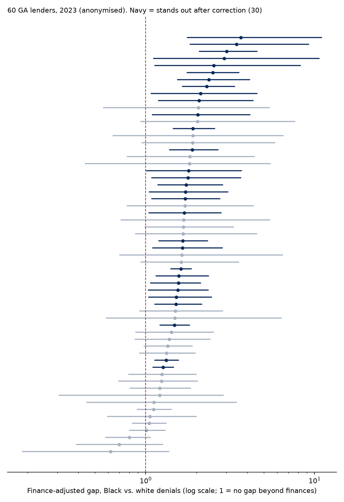

# Lender audit with a multiple-testing correction, GA 2023 (anonymised)

GA 2023: 60 auditable lenders. 30 have a 95% range entirely above 1 (1,000 draws); 30 (50%) still stand out after the Benjamini-Hochberg correction for testing 60 lenders at once (false discovery rate 5%).

| lender    |   applications |   finance-adjusted gap (x) | 95% range   |   BH q | passes BH (5% FDR)   |
|:----------|---------------:|---------------------------:|:------------|-------:|:---------------------|
| Lender 1  |           9365 |                       1.62 | 1.41–1.87   |  0.007 | True                 |
| Lender 2  |           6893 |                       1.27 | 1.10–1.46   |  0.009 | True                 |
| Lender 3  |           4422 |                       1.66 | 1.19–2.33   |  0.015 | True                 |
| Lender 4  |           3715 |                       1.56 | 1.07–2.12   |  0.03  | True                 |
| Lender 5  |           3651 |                       3.01 | 2.08–4.56   |  0.007 | True                 |
| Lender 6  |           2924 |                       1.11 | 0.89–1.42   |  0.2   | False                |
| Lender 7  |           2837 |                       1.89 | 1.38–2.68   |  0.007 | True                 |
| Lender 8  |           2655 |                       1.48 | 1.22–1.82   |  0.007 | True                 |
| Lender 9  |           2617 |                       1.57 | 1.15–2.36   |  0.009 | True                 |
| Lender 10 |           2332 |                       1.52 | 1.04–2.46   |  0.037 | True                 |
| Lender 11 |           2176 |                       1.32 | 1.13–1.57   |  0.007 | True                 |
| Lender 12 |           2116 |                       2.49 | 1.76–3.56   |  0.007 | True                 |
| Lender 13 |           2109 |                       1.69 | 1.04–2.79   |  0.037 | True                 |
| Lender 14 |           1628 |                       2.92 | 1.11–10.62  |  0.035 | True                 |
| Lender 15 |           1450 |                       1.72 | 1.05–3.07   |  0.037 | True                 |
| Lender 16 |           1418 |                       1.91 | 1.45–2.57   |  0.009 | True                 |
| Lender 17 |           1348 |                       1.74 | 1.18–2.86   |  0.015 | True                 |
| Lender 18 |           1344 |                       1.35 | 0.98–1.89   |  0.06  | False                |
| Lender 19 |           1330 |                       1.33 | 0.92–1.97   |  0.121 | False                |
| Lender 20 |           1294 |                       2.3  | 1.65–3.37   |  0.007 | True                 |
| Lender 21 |           1215 |                       1.01 | 0.80–1.31   |  0.465 | False                |
| Lender 22 |           1200 |                       1.55 | 1.04–2.34   |  0.036 | True                 |
| Lender 23 |           1184 |                       1.05 | 0.84–1.32   |  0.387 | False                |
| Lender 24 |           1171 |                       1.51 | 1.13–2.15   |  0.013 | True                 |
| Lender 25 |           1157 |                       1.71 | 1.09–2.75   |  0.029 | True                 |
| Lender 26 |           1054 |                       1.67 | 0.87–4.55   |  0.121 | False                |
| Lender 27 |           1049 |                       3.66 | 1.77–11.01  |  0.009 | True                 |
| Lender 28 |           1040 |                       1.24 | 0.69–2.03   |  0.258 | False                |
| Lender 29 |            999 |                       1.9  | 0.64–6.51   |  0.155 | False                |
| Lender 30 |            934 |                       1.21 | 0.81–1.84   |  0.2   | False                |
| Lender 31 |            917 |                       1.65 | 1.10–2.84   |  0.025 | True                 |
| Lender 32 |            916 |                       3.45 | 1.83–9.21   |  0.007 | True                 |
| Lender 33 |            880 |                       0.8  | 0.58–1.06   |  0.934 | False                |
| Lender 34 |            872 |                       1.67 | 0.99–3.31   |  0.056 | False                |
| Lender 35 |            853 |                       1.82 | 0.44–5.47   |  0.173 | False                |
| Lender 36 |            803 |                       2.04 | 1.09–4.15   |  0.034 | True                 |
| Lender 37 |            737 |                       2.06 | 0.56–5.40   |  0.146 | False                |
| Lender 38 |            704 |                       1.38 | 0.87–2.40   |  0.133 | False                |
| Lender 39 |            696 |                       2.53 | 1.13–8.25   |  0.025 | True                 |
| Lender 40 |            578 |                       1.89 | 0.95–5.81   |  0.065 | False                |
| Lender 41 |            560 |                       1.21 | 0.31–2.88   |  0.404 | False                |
| Lender 42 |            560 |                       1.12 | 0.45–3.44   |  0.433 | False                |
| Lender 43 |            554 |                       2.07 | 1.19–4.32   |  0.025 | True                 |
| Lender 44 |            537 |                       1.64 | 0.70–6.47   |  0.155 | False                |
| Lender 45 |            527 |                       2.36 | 1.55–4.12   |  0.007 | True                 |
| Lender 46 |            511 |                       2.12 | 1.08–4.57   |  0.037 | True                 |
| Lender 47 |            506 |                       1.71 | 0.78–4.34   |  0.126 | False                |
| Lender 48 |            500 |                       1.78 | 1.09–3.65   |  0.029 | True                 |
| Lender 49 |            488 |                       0.62 | 0.19–1.37   |  0.896 | False                |
| Lender 50 |            440 |                       1.5  | 0.92–2.86   |  0.102 | False                |
| Lender 51 |            438 |                       1.79 | 1.01–3.69   |  0.05  | True                 |
| Lender 52 |            431 |                       1.25 | 0.79–1.99   |  0.2   | False                |
| Lender 53 |            372 |                       1.06 | 0.59–1.99   |  0.433 | False                |
| Lender 54 |            371 |                       0.7  | 0.39–1.26   |  0.896 | False                |
| Lender 55 |            369 |                       1.42 | 0.87–2.52   |  0.133 | False                |
| Lender 56 |            289 |                       1.49 | 0.59–6.35   |  0.239 | False                |
| Lender 57 |            286 |                       1.62 | 0.94–3.55   |  0.094 | False                |
| Lender 58 |            276 |                       2.03 | 0.93–7.63   |  0.065 | False                |
| Lender 59 |            275 |                       1.82 | 0.78–4.39   |  0.122 | False                |
| Lender 60 |            218 |                       1.68 | 0.71–5.43   |  0.155 | False                |
