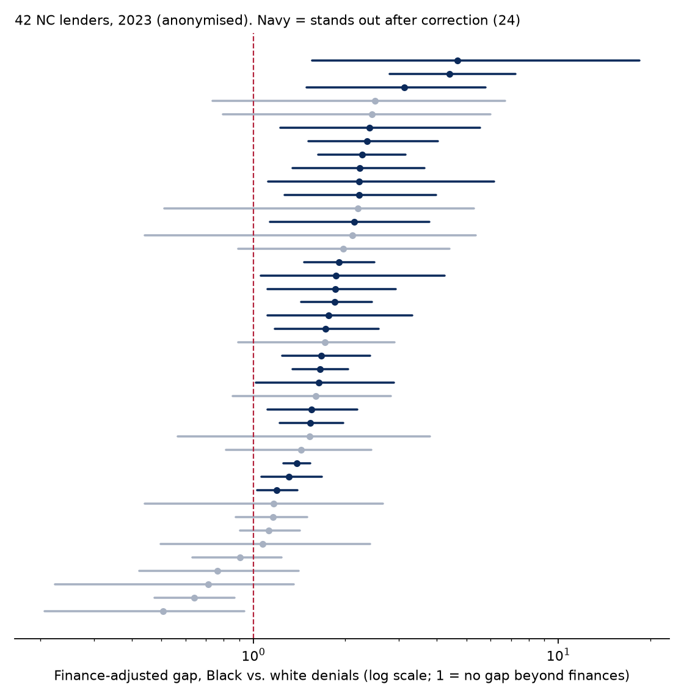

# Lender audit with a multiple-testing correction, NC 2023 (anonymised)

NC 2023: 42 auditable lenders. 24 have a 95% range entirely above 1 (1,000 draws); 24 (57%) still stand out after the Benjamini-Hochberg correction for testing 42 lenders at once (false discovery rate 5%).

| lender    |   applications |   finance-adjusted gap (x) | 95% range   |   BH q | passes BH (5% FDR)   |
|:----------|---------------:|---------------------------:|:------------|-------:|:---------------------|
| Lender 1  |          10997 |                       1.39 | 1.25–1.54   |  0.006 | True                 |
| Lender 2  |           7969 |                       2.27 | 1.63–3.16   |  0.006 | True                 |
| Lender 3  |           5114 |                       1.16 | 0.88–1.50   |  0.174 | False                |
| Lender 4  |           5026 |                       1.12 | 0.91–1.42   |  0.174 | False                |
| Lender 5  |           4149 |                       3.13 | 1.50–5.78   |  0.02  | True                 |
| Lender 6  |           3880 |                       1.65 | 1.34–2.05   |  0.006 | True                 |
| Lender 7  |           3645 |                       1.86 | 1.11–2.93   |  0.02  | True                 |
| Lender 8  |           2928 |                       1.71 | 0.89–2.91   |  0.079 | False                |
| Lender 9  |           2558 |                       1.91 | 1.47–2.50   |  0.006 | True                 |
| Lender 10 |           2522 |                       1.19 | 1.03–1.39   |  0.02  | True                 |
| Lender 11 |           2322 |                       1.54 | 1.22–1.97   |  0.006 | True                 |
| Lender 12 |           2144 |                       1.31 | 1.06–1.68   |  0.022 | True                 |
| Lender 13 |           2117 |                       4.4  | 2.80–7.24   |  0.006 | True                 |
| Lender 14 |           1978 |                       2.23 | 1.34–3.64   |  0.008 | True                 |
| Lender 15 |           1915 |                       2.51 | 0.73–6.70   |  0.092 | False                |
| Lender 16 |           1875 |                       1.85 | 1.43–2.45   |  0.006 | True                 |
| Lender 17 |           1725 |                       1.67 | 1.25–2.42   |  0.008 | True                 |
| Lender 18 |           1479 |                       1.72 | 1.17–2.57   |  0.015 | True                 |
| Lender 19 |           1404 |                       1.55 | 1.11–2.19   |  0.014 | True                 |
| Lender 20 |           1206 |                       2.14 | 1.13–3.77   |  0.021 | True                 |
| Lender 21 |           1204 |                       1.64 | 1.02–2.89   |  0.035 | True                 |
| Lender 22 |           1192 |                       0.91 | 0.63–1.24   |  0.829 | False                |
| Lender 23 |           1160 |                       2.11 | 0.44–5.37   |  0.167 | False                |
| Lender 24 |           1158 |                       2.45 | 0.79–6.00   |  0.093 | False                |
| Lender 25 |           1145 |                       2.36 | 1.52–4.04   |  0.008 | True                 |
| Lender 26 |            856 |                       2.2  | 0.51–5.29   |  0.136 | False                |
| Lender 27 |            809 |                       2.4  | 1.23–5.55   |  0.024 | True                 |
| Lender 28 |            746 |                       1.6  | 0.86–2.82   |  0.093 | False                |
| Lender 29 |            743 |                       0.71 | 0.22–1.35   |  0.884 | False                |
| Lender 30 |            735 |                       1.53 | 0.56–3.80   |  0.174 | False                |
| Lender 31 |            716 |                       1.76 | 1.11–3.32   |  0.025 | True                 |
| Lender 32 |            681 |                       1.17 | 0.44–2.66   |  0.418 | False                |
| Lender 33 |            600 |                       1.97 | 0.89–4.40   |  0.079 | False                |
| Lender 34 |            565 |                       0.64 | 0.47–0.87   |  0.999 | False                |
| Lender 35 |            537 |                       1.43 | 0.81–2.43   |  0.139 | False                |
| Lender 36 |            537 |                       1.86 | 1.06–4.23   |  0.031 | True                 |
| Lender 37 |            536 |                       2.22 | 1.26–3.98   |  0.014 | True                 |
| Lender 38 |            470 |                       0.51 | 0.21–0.94   |  0.999 | False                |
| Lender 39 |            450 |                       0.76 | 0.42–1.41   |  0.871 | False                |
| Lender 40 |            441 |                       4.66 | 1.56–18.47  |  0.015 | True                 |
| Lender 41 |            440 |                       1.07 | 0.50–2.42   |  0.488 | False                |
| Lender 42 |            407 |                       2.22 | 1.12–6.16   |  0.023 | True                 |
